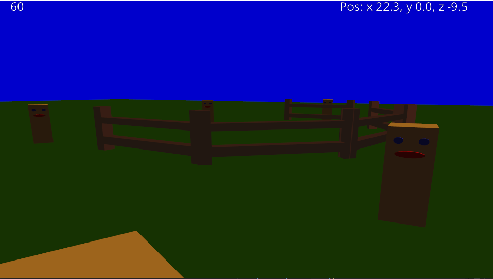
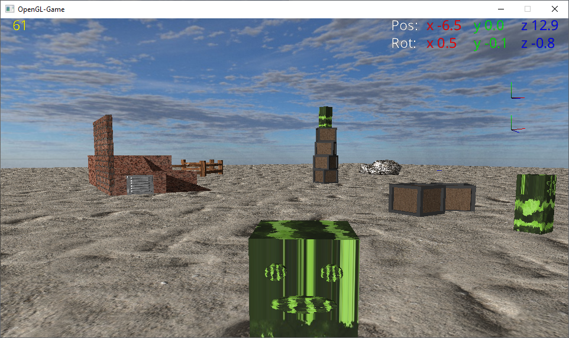
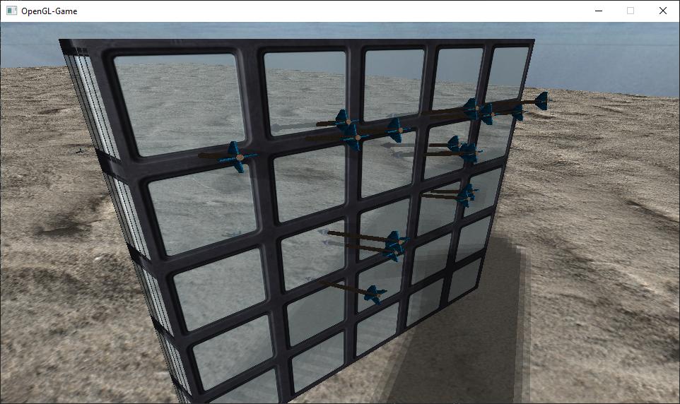
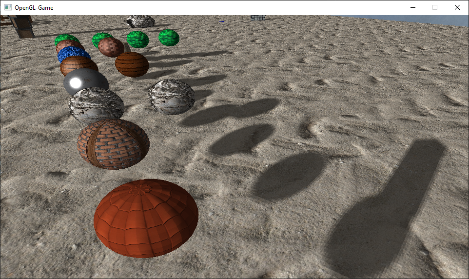

# OpenGL_Game
a simple game in 3D programmed directly with OpenGL

## Building

Requirements: CMake 3.24 or newer, a C++17 compiler, and Git.  On Windows,
Visual Studio 2022 (or MinGW-w64) is supported; on Linux you additionally need
the OpenGL and X11 development packages.  On Debian/Ubuntu:

```bash
sudo apt install build-essential cmake git libgl1-mesa-dev libglx-dev \
  libx11-dev libxext-dev libxrandr-dev libxi-dev libxcursor-dev \
  libxinerama-dev libxfixes-dev libxss-dev
```

Configure and build:

```bash
cmake -S . -B build
cmake --build build --config Release
```

Most dependencies are downloaded automatically into `libs/_deps/`.  The game and
server change into their executable directory at startup, so both can be
launched from anywhere.  The executables are written next to their assets:

```bash
./Game/OpenGL_Game
./GameServer/GameServer
```

On Windows the names are `Game\OpenGL_Game.exe` and `GameServer\GameServer.exe`.
The generated convenience targets pass the correct working directory:

```bash
cmake --build build --target run_game
cmake --build build --target run_server
```

Useful CMake options:

| Option | Default | Meaning |
| --- | --- | --- |
| `OG_BUILD_GAME` | `ON` | Build the game client |
| `OG_BUILD_SERVER` | `ON` | Build the dedicated server |
| `OG_BUILD_MODELCONVERTER` | `OFF` | Build the Assimp-based converter |
| `OG_ENABLE_AUDIO` | `ON` | Build SoLoud audio with 3D sound; `OFF` builds a silent client |
| `OG_USE_SYSTEM_DEPS` | `OFF` | Prefer system/vcpkg packages |
| `OG_FETCH_DEPS` | `ON` | Download missing dependencies |
| `OG_BUILD_TESTS` | `ON` | Build the Catch2 unit tests for the shared `common/` code |
| `OG_DEPS_DIR` | `libs/_deps` | Where downloaded dependencies are stored |

For a server-only build (for example on a headless Linux machine without
OpenGL/X11), configure with `-DOG_BUILD_GAME=OFF`.  The server does not need
SDL2, GLEW, OpenGL, Lua, or SoLoud and builds with only a C++17 compiler and
Git.

To use a separate dependency cache for another compiler or platform, pass for
example `-DOG_DEPS_DIR=libs/_deps-linux`.

Audio uses the open-source [SoLoud](https://soloud-audio.com/) engine with its
SDL2 backend.  It supports 2D and 3D positional audio, looping, and MP3/WAV/OGG
playback.  SoLoud is downloaded automatically; no proprietary SDK is required.

Models can be created with Blender and then exported as OBJ format for example. Also FBX format works great for me.
The ModelConverter Tool import the Vertices, Indices and the Material from the file(s)(in case of OBJ an extra MTL file will be created and needed
using the Open-Asset-Importer-Library. The tool then exports the data into a custom BMF file. where the data can be loaded by the game faster.

The Game itself use the Library SDL to create a window and OpenGL-context. Also the Library GLEW is used to get the current OpenGL functions.
For the mathematics (Matrices and Vectors) the Library OpenGL Mathematics is used.

On the Graphics Card side i use the shader programming language GLSL
https://www.khronos.org/opengl/wiki/Core_Language_(GLSL)

For importing Textures and Fonts i use the STB Library.

As Mapfiles i use the XML format. To parse them i use the tinyxml2 Library.

for playing audio the open-source SoLoud-Library is used.

The idea and the knowlegde for this project did i get from this german youtube OpenGL tutorial playlist:
https://www.youtube.com/playlist?list=PLStQc0GqppuWBDuNWnkQ8rzmyx35AINyt
https://github.com/Pilzschaf/OpenGLTutorial

On of the first versions that had just material properties and no textures

Implementation of textures, skybox, colored hud elements.
That version had also already simple physic, the boxes in the middle are standing on top of each other

Transparent textures with alpha blending and arrows that have collision with the object and get stuck in it

A couple of testballs to test different textures and material properties. Metal (left in the middle) doesnt look well with the phong shading model.
It is missing reflections of the world. Also the game renders shadows with the shadow mapping technique



used Libaries:

Assimp for model loading and converting
https://www.assimp.org/
https://github.com/assimp/assimp

SDL for creating a window and the OpenGL-Context
https://www.libsdl.org/

OpenGL for rendering 3D objects
https://www.opengl.org/
https://github.com/topics/opengl

GLEW for easier handling of new OpenGL functions
http://glew.sourceforge.net/
https://github.com/nigels-com/glew

GLM for the matrices/vector calculations
https://glm.g-truc.net/0.9.9/index.html
https://github.com/g-truc/glm

stb for loading fonts and textures/images
https://github.com/nothings/stb
https://github.com/nothings/stb/blob/master/stb_image.h
https://github.com/nothings/stb/blob/master/stb_truetype.h

TinyXML2 for parsing the level-file
https://github.com/leethomason/tinyxml2

SoLoud for 2D and 3D audio (open source, zlib/libpng license)
https://soloud-audio.com/
https://github.com/jarikomppa/soloud

used Textures from:
https://3dtextures.me

## Unit tests

The shared, platform-independent code in `common/` (`Helper`, `Logger`,
`StopWatch`, and the `Types` enums/structs) is covered by Catch2 unit tests in
`tests/`. They build a small `og_tests` executable and are run through CTest.

```bash
cmake -S . -B build -DOG_BUILD_TESTS=ON
cmake --build build
ctest --test-dir build --output-on-failure
```

The tests only link `common/` sources, GLM and Catch2, so they run without a
GPU or the OpenGL client. GitHub Actions (`.github/workflows/ci.yml`) builds
the headless server and runs these tests on Linux and Windows.